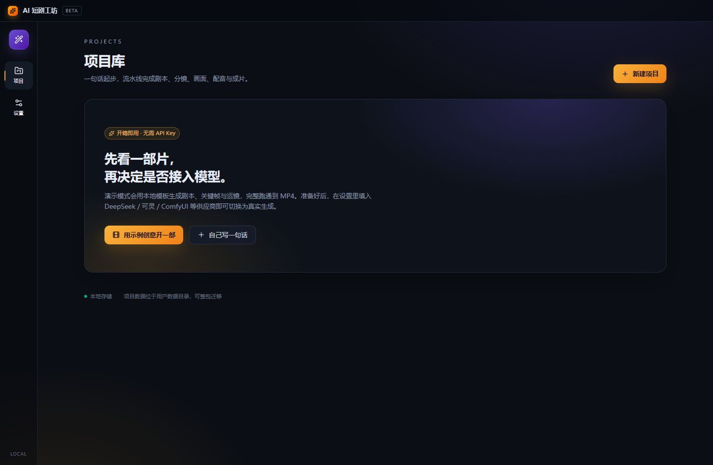
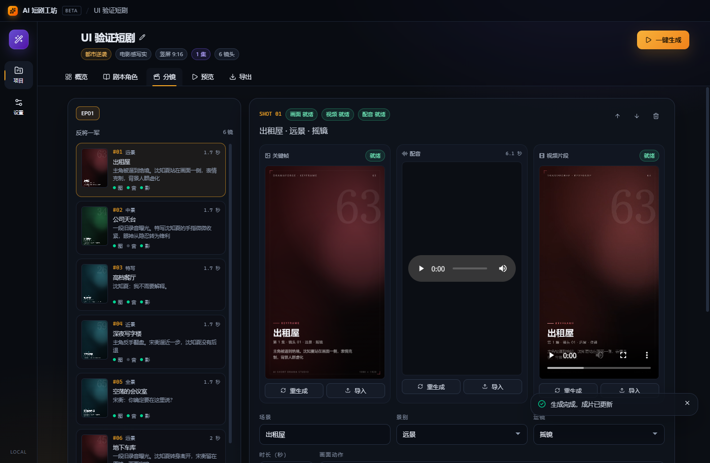

# AI 短剧工坊（DramaForge）

本地优先的 **AI 短剧一键制作桌面工作台**，支持 Windows / macOS。

输入一句话或一段剧本，自动完成：

> 创意扩写 → 角色圣经 → 分集大纲 → 分镜脚本 → 关键帧 → 配音 → 视频片段 → 字幕 → 成片 MP4

每个阶段可单独重跑，每个镜头可人工修改提示词后单独重生成。无 API Key 时进入**演示模式**，也能完整跑通到成片。





## 功能

- **一键成片**：从一句话到竖屏 9:16 / 横屏 16:9 的 H.264 MP4。
- **分镜编辑器**：景别、运镜、时长、台词、旁白、画面/视频/负面提示词逐项可改。
- **角色一致性**：角色外观锚点自动拼进每张关键帧提示词，支持角色定妆照。
- **断点续跑与失效标记**：改角色、改镜头后，下游自动标记「待更新」，只重跑需要的部分。
- **多供应商可插拔**：
  - 剧本：任意 OpenAI 兼容 Chat Completions（DeepSeek / 通义千问 / 智谱 / OpenAI）
  - 图像：OpenAI 兼容 Images、可灵、ComfyUI 工作流、演示渲染器
  - 视频：可灵图生视频、ComfyUI 工作流、本地运镜演示
  - 配音：Windows SAPI / macOS `say`、OpenAI 兼容 TTS、静音
- **本地媒体处理**：内置 ffmpeg/ffprobe，统一规格、拼接、混音、字幕烧录、全剧合并。
- **本地优先**：项目、素材、Key 全部在本机；API Key 使用系统安全存储加密（DPAPI / Keychain）。若系统安全存储不可用，应用会拒绝保存 Key，而不是退化为明文。
- **开箱即用**：演示模式使用本地模板编剧 + 离屏浏览器渲染中文关键帧 + ffmpeg 运镜，不需要任何账号。
- **数据安全**：项目文件原子写入并保留 `.bak`；关闭窗口前同步落盘；生成期间暂锁编辑，避免流水线与手动修改互相覆盖。

## 快速开始

要求：Node.js ≥ 20.19，npm ≥ 10。

```bash
npm install
npm run dev
```

首次启动建议直接点「用示例创意开一部」→「一键生成」，约 30 秒即可看到演示成片。

### 常用命令

| 命令 | 说明 |
| --- | --- |
| `npm run dev` | 开发模式（热更新） |
| `npm run build` | 构建主进程 / 预加载 / 渲染进程 |
| `npm test` | Vitest 单测 + 流水线集成测试（会真实调用 ffmpeg 出片） |
| `npm run smoke` | 无界面端到端自检，产出 MP4 后退出 |
| `npm run smoke:ui` | 启动界面，自动建项目、跑流水线并截图到 `C:/Projects/tmp/ai-shortdrama-ui` |
| `npm run dist:win` | 生成 Windows NSIS 安装包 |
| `npm run dist:mac` | 在 macOS 上生成 dmg / zip |

## 演示模式

设置 → 运行模式 → 「优先演示模式」默认开启：

- 剧本：内置中文短剧模板，按创意/题材确定角色、分集与分镜。
- 关键帧：Electron 离屏渲染中文电影感占位卡。
- 视频：ffmpeg `zoompan` 推拉摇移。
- 配音：默认使用系统语音（Windows 需中文语音包；macOS 自带中文语音），可在设置里改为静音。

演示链路与真实模型共用同一套流水线、提示词构建和渲染代码，切换供应商后直接复用。

## 接入真实模型

打开「设置」，每个供应商都可「测试连接」（会先保存当前配置）。

### 剧本 LLM

填 OpenAI 兼容的 Base URL、模型名和 API Key：

| 服务 | Base URL | 示例模型 |
| --- | --- | --- |
| DeepSeek | `https://api.deepseek.com/v1` | `deepseek-chat` |
| 通义千问 | `https://dashscope.aliyuncs.com/compatible-mode/v1` | `qwen-plus` |
| 智谱 GLM | `https://open.bigmodel.cn/api/paas/v4` | `glm-4-plus` |
| OpenAI | `https://api.openai.com/v1` | `gpt-4.1-mini` |

模型输出会经过 Zod 校验；JSON 非法时自动带错误摘要重试一次。

### 可灵（图像 / 视频）

- Base URL：`https://api-beijing.klingai.com`
- 同时填 Access Key 与 Secret Key（用于生成 JWT）。
- 图像模型默认 `kling-v2`，视频模型默认 `kling-v2-5-turbo`，模式可选标准/专业。
- 视频会按 5 秒或 10 秒出片，合成时自动裁切到镜头时长。

> 可灵接口字段可能随版本调整；若报错，请以官方文档为准修改 `src/main/services/providers/kling.ts`。

### ComfyUI

1. 启动本地 ComfyUI（默认 `http://127.0.0.1:8188`）。
2. 在 ComfyUI 里搭好文生图 / 图生视频工作流，导出 API 格式 JSON。
3. 在设置中选择该 JSON。工作流中的占位符会被替换：

| 占位符 | 含义 |
| --- | --- |
| `__PROMPT__` | 画面/视频提示词 |
| `__NEGATIVE__` | 负面提示词 |
| `__SEED__` | 随机种子 |
| `__WIDTH__` / `__HEIGHT__` | 目标尺寸 |
| `__IMAGE__` | 图生视频时上传的关键帧文件名 |
| `__DURATION__` | 目标时长（秒） |

占位符需写成字符串值（例如节点里的 `text` 字段），数值节点请单独使用，不要依赖类型转换。

### 配音

- **系统语音**：无需 Key。Windows 可在「设置 → 时间和语言 → 语音」安装中文语音包；macOS 自带婷婷等中文语音。
- **OpenAI 兼容 TTS**：填 Base URL / 模型 / Voice / Key。

## 构建安装包

### Windows

```bash
npm run dist:win
```

产物：`release/AI短剧工坊-Setup-1.0.0.exe`（NSIS，可选安装目录）。

### macOS

必须在 Mac 上构建（electron-builder 不支持从 Windows 交叉生成 dmg）：

```bash
bash scripts/build-mac.sh
```

脚本按**当前机器架构**打包（ffmpeg-static 在安装时只下载当前架构的二进制，交叉打包会嵌入错误架构的 ffmpeg）。

需要同时产出 Intel 与 Apple Silicon 两个版本时，使用 `.github/workflows/build-mac.yml`：它在 `macos-13`（x64）与 `macos-14`（arm64）上分别安装依赖并打包，上传两个独立工件。

未签名版本首次打开会被 Gatekeeper 拦截，可：

- 右键 App → 打开；或
- 终端执行 `xattr -dr com.apple.quarantine "/Applications/AI短剧工坊.app"`。

需要签名/公证时，提供 `CSC_LINK`、`CSC_KEY_PASSWORD`、`APPLE_ID`、`APPLE_APP_SPECIFIC_PASSWORD`、`APPLE_TEAM_ID` 环境变量，并在 `electron-builder.yml` 的 `mac` 段启用公证。

## 数据与隐私

- 项目目录：`<userData>/projects/<uuid>/`，其中 `project.json` 记录全部状态，`assets/` 存放图片、音频、视频、字幕与成片。
- 设置文件：`<userData>/settings.json`，密钥字段加密后写入。
- 项目可整包复制迁移；导出页提供「导出工程包」与「打开项目目录」。
- 渲染进程通过自定义协议 `drama-asset://` 只读访问项目 `assets/`，路径做了越界校验。
- 不内置任何 API Key，也不会把素材上传到第三方（除你配置的供应商外）。

## 项目结构

```
src/
  main/                  Electron 主进程
    bootstrap.ts         服务装配
    ipc.ts               IPC 契约实现
    smoke.ts / uiSmoke.ts 无界面与 UI 自检
    services/
      projectStore.ts    项目 JSON 存储（原子写 + 备份）
      settingsStore.ts   设置与密钥掩码
      keyVault.ts        safeStorage 加解密
      taskQueue.ts       任务与并发池
      media/             ffmpeg 封装、字幕
      providers/         LLM / 图像 / 视频 / TTS 适配器
      pipeline/          流水线引擎、提示词、JSON 修复
      render/            离屏关键帧渲染与模板
  preload/               contextBridge API
  shared/                类型、IPC 通道、常量
  renderer/              React 19 + Tailwind 4 界面
tests/                   Vitest 单测与集成测试
```

## 测试与自检

```bash
npm test          # 26 项测试：JSON、字幕、存储、提示词、演示编剧、流水线集成
npm run smoke     # 真实产出 MP4，输出 SMOKE_OK {...}
npm run smoke:ui  # 走完整界面流程并截图
```

流水线集成测试会真实调用内置 ffmpeg 生成 1080×1920 成片并校验时长、分辨率与音轨。

## 已知限制

- 演示模式的画面是设计占位卡，用于验证流程，不是最终画质；真实画质取决于所接模型。
- 可灵 / ComfyUI 适配器按公开接口实现，供应商字段变更时需要同步调整适配器。
- 字幕烧录依赖 ffmpeg 的 libass 滤镜；若运行环境不支持，会自动回退为无字幕视频并保留 `.srt`，同时在阶段消息里标记「字幕降级」，不会静默成功。
- 生成过程中项目内容会暂锁编辑，避免流水线持久化旧快照覆盖手动修改；生成结束后可继续编辑。
- 部分集合成失败时，阶段会标记失败并保留已成功集的成片，重试即可补齐，不会被当作全部成功。
- 暂无多轨时间线、团队协作、云同步、画布节点视图；数据模型已为后续画布化预留扩展空间。

## 许可

MIT
